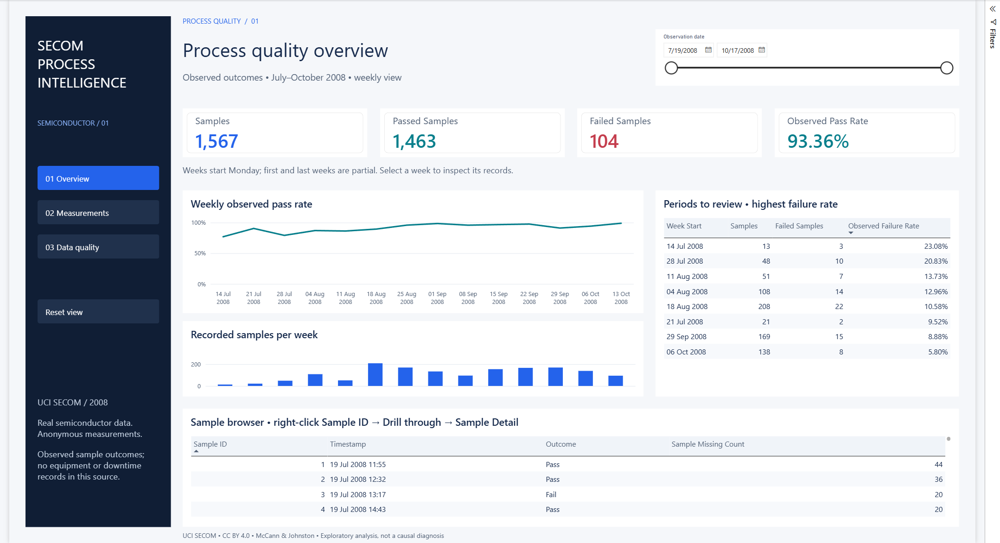
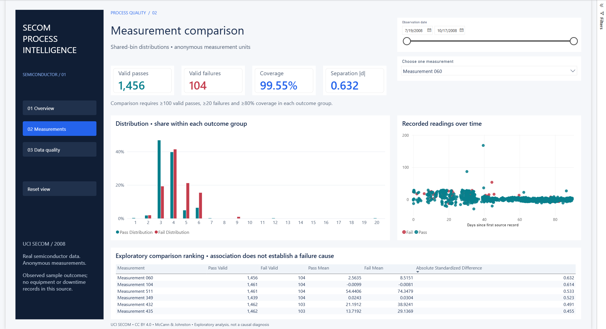
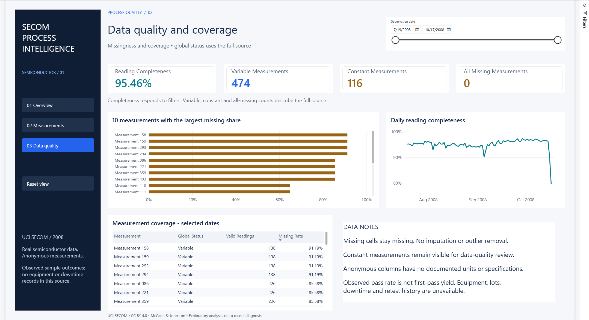
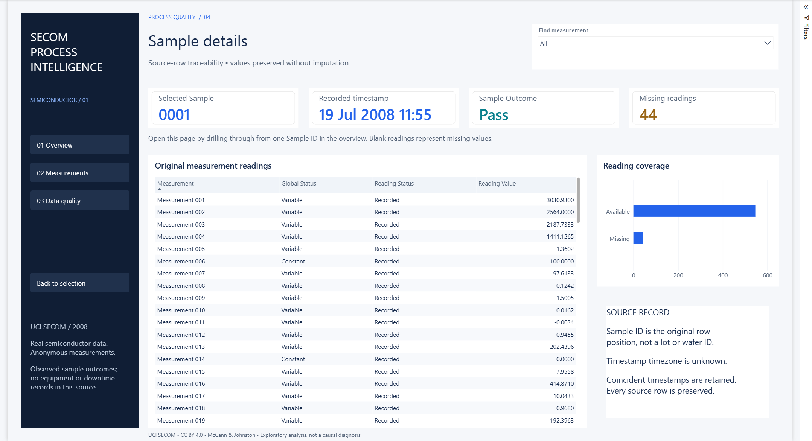
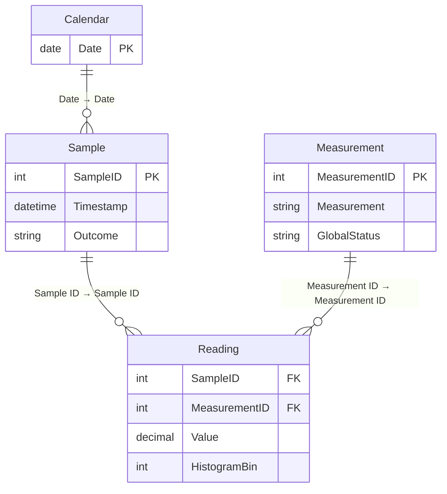

# Semiconductor Process Quality & Yield Analysis

A Power BI report for reviewing semiconductor test outcomes, comparing process measurements and checking data completeness.

**Manufacturing analytics · Power BI · Power Query · DAX**

[Report preview](#explore-the-report) · [Findings](#what-the-data-shows) · [Open in Power BI](#open-locally) · [Model and calculations](docs/technical-notes.md)



**1,567 samples · 590 measurements · 93.36% observed pass rate · real UCI SECOM data**

A quality review needs more than a pass-rate card. It needs enough context to decide what to investigate next:

- **When did failures increase?** Compare weekly outcomes with the number of samples recorded.
- **Which measurements deserve a closer look?** Compare pass and fail distributions using the same bins and check group coverage.
- **Can the underlying readings support the comparison?** Review missing values, constant measurements and individual source records.

Start with the overview, select a measurement, then drill through to a sample. Each page supports the next step in that review.

## What the data shows

| Finding | Interpretation |
|---|---|
| 1,463 passes and 104 failures | Observed pass rate is **93.36%**; this is not verified first-pass or whole-factory yield. |
| 41,951 of 924,530 expected readings are missing | Overall completeness is **95.46%**. Missingness is uneven: 28 measurements are more than half missing. |
| 116 measurements are constant; 474 vary | Constant fields remain visible for data-quality review and cannot explain group separation through variation. |
| The first partial week has 3 failures in 13 samples | Its 23.08% failure rate warrants context: a small denominator makes the rate unstable. |
| Measurements 060 and 104 have the largest eligible standardized group differences, about 0.632 and 0.614 | These are descriptive leads for investigation. The source provides no physical meanings, units, or causal evidence. |

The period is 19 July–17 October 2008. There are records on 86 of 91 calendar dates; record counts must not be treated as complete factory production. All results above use the full supplied dataset. [Source profile](docs/data-profile.json)

## Explore the report

| Page | Question it answers | Interaction |
|---|---|---|
| Quality Overview | When do outcomes warrant investigation? | Select dates or a week; inspect counts alongside rates. |
| Measurement Investigation | How do valid readings differ between pass and fail? | Choose a measurement; compare normalized distributions and individual readings. |
| Data Quality & Coverage | Where is the evidence incomplete or uninformative? | Inspect missingness and coverage for the selected dates. |
| Sample Detail | What was actually recorded for one sample? | Right-click a Sample ID in the overview → **Drill through → Sample Detail**. |

<details>
<summary>Measurement investigation</summary>



</details>

<details>
<summary>Data quality and coverage</summary>



</details>

<details>
<summary>Individual sample evidence</summary>



</details>

Screenshots are captured from the actual report in Power BI Desktop. They are static previews; GitHub does not run an interactive Power BI report.

## How it works

- **Power Query:** row-aligned ingestion, explicit timestamp parsing, null preservation, source validation and measurement profiling. The reading table is built by measurement without a large text-key merge.
- **Modelling:** separate sample and reading grains, single-direction relationships, a contiguous calendar and disconnected selector tables.
- **DAX:** protected outcome denominators, weighted aggregate rates, dynamic completeness, normalized histograms and descriptive group comparisons.
- **Report design:** four coordinated pages, consistent status colours, navigation, date filtering, tooltips and source-row drillthrough.
- **Validation:** **5,874 passing measure checks**, plus an exact comparison of every imported reading and missing position. [Measure checks](docs/model-validation.json) · [All-reading checks](docs/reading-validation.json)
- **Refresh performance:** full refresh reduced from **8m 12s to 79–85 seconds** in the recorded local runs, with all source readings preserved. [Timing and scope](docs/refresh-validation.json)
- **Project source:** editable PBIP/PBIR/TMDL files; temporary files and local caches are excluded from Git.



The reading table holds **882,579 nonmissing values**. Missing sample–measurement pairs remain in completeness denominators and appear as missing in sample detail. Three small disconnected tables support measurement selection, histogram bins and the coverage legend. [Model, calculations and decisions](docs/technical-notes.md)

## Open locally

1. Clone or download the complete repository to a Windows computer with Power BI Desktop. The report was developed with Desktop **2.158.1177.0**; use a version that supports PBIP, PBIR and TMDL.
2. With this project closed in Desktop, run the following from the repository root. The script points the **Data Folder** parameter to this checkout's `data` folder:

   ```powershell
   powershell -ExecutionPolicy Bypass -File .\scripts\configure_data.ps1
   ```

3. Open [`powerbi/SemiconductorQuality.pbip`](powerbi/SemiconductorQuality.pbip).
4. Select **Home → Refresh**, and wait for the import to finish. Two optimized full refreshes took **79–85 seconds** on the development machine; your timing may differ. If requested, permit access to the two local source files. No Power BI account, paid licence or Service deployment is needed for this local workflow.
5. Use the date slicer and measurement dropdown. In Desktop edit mode, **Ctrl+click** navigation/reset buttons. Drill through from a Sample ID to inspect its readings.

Alternatively, set **Data Folder** through **Transform data → Manage parameters** to the absolute directory containing `secom.data` and `secom_labels.data`, then apply and refresh. A new clone does not include cached data; refresh is required. Parameter configuration changes one local source file—do not publish your machine-specific path.

The repository contains an editable PBIP project. A PBIX/PBIT download is not currently included.

## Project files

| Folder | Contents |
|---|---|
| `powerbi/` | Report pages, Power Query definitions, relationships and DAX measures. |
| `data/` | Original UCI files and source attribution. |
| `docs/` | Screenshots, technical decisions and verification results. |
| `scripts/` | Local setup, source profiling and data validation. |

## Reproduce the checks

```powershell
python -m pip install -r scripts/requirements.txt
python scripts/profile_secom.py
```

This regenerates the profile without changing source data. For live model reconciliation, follow the commands in [technical notes](docs/technical-notes.md#verification).

## Use your own data

The analytical pattern is reusable after mapping a company's data to a sample outcome, timestamp and set of numeric measurements. The supplied importer expects SECOM's exact file structure and 590 measurement columns. A different source requires adapting Power Query, the source keys, column count and outcome mapping, then repeating the validation. [Reuse checklist and input contract](docs/technical-notes.md#reuse-with-another-source)

## Source and limitations

McCann, M. & Johnston, A. (2008). **SECOM** [Dataset]. UCI Machine Learning Repository. [Dataset and documentation](https://archive.ics.uci.edu/dataset/179/secom) · [DOI](https://doi.org/10.24432/C54305).

Data is licensed **CC BY 4.0**. Original extracted files are preserved unchanged; attribution and checksum details are in [data/ATTRIBUTION.md](data/ATTRIBUTION.md). Project code and documentation use the [MIT licence](LICENSE); it does not replace the dataset licence.

The source does not disclose company identity, equipment, lots, measurement meanings or units, specification limits, downtime or retest history. This report therefore does not calculate equipment availability, OEE, Cp/Cpk or verified first-pass yield. Exploratory group differences do not establish failure causes and have not been validated on a separate dataset.
